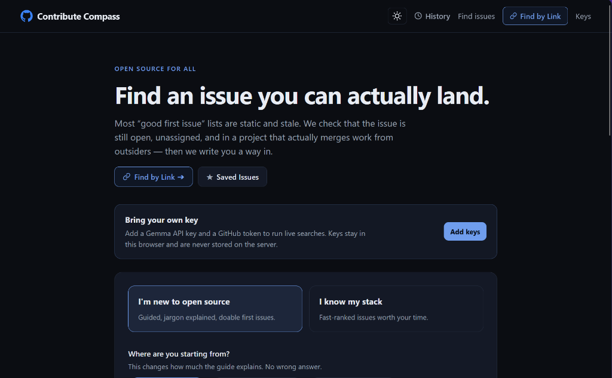
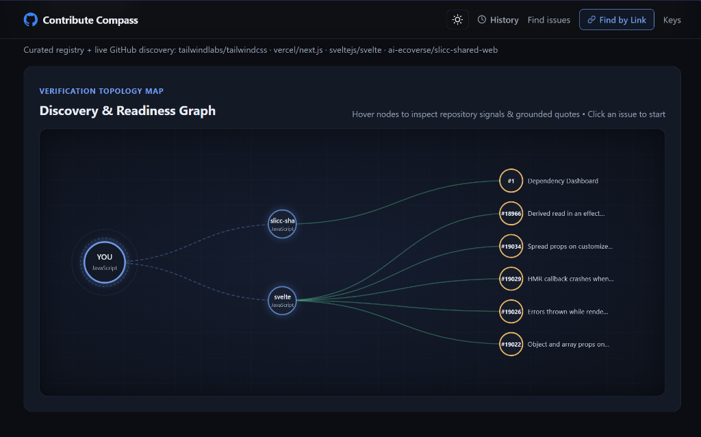
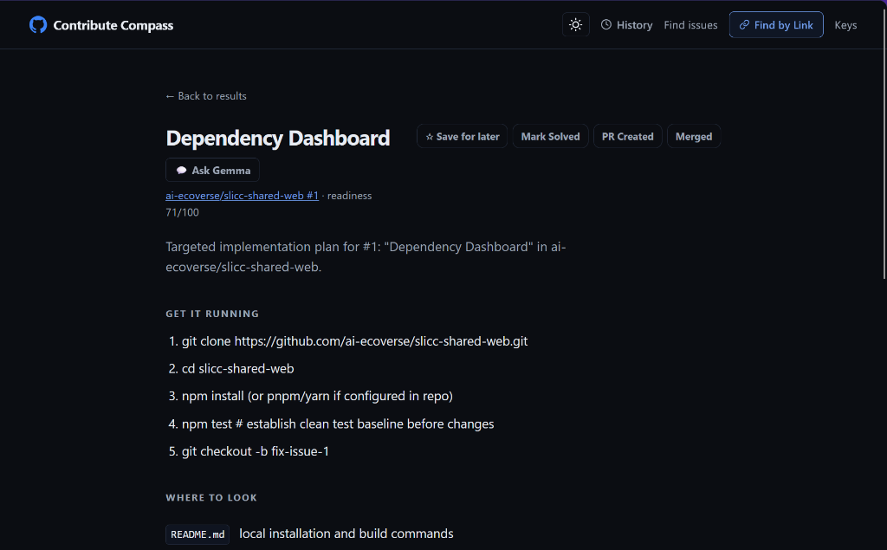

# 🧭 Contributor Compass
*Open Source For All*

> **"Verified, not listed."**  
> Existing discovery tools hand developers a static list of `good first issue` tags. **Contributor Compass** transforms a developer's skills and goals into a **live-verified, ready-to-work path into open source** — with checkable evidence for every claim.

[](https://aistudio.google.com/)
[](core/verify/jev.ts)
[](core/guide/guide.ts)
[](https://hacktoberfest.com/)
[](LICENSE)
[](.env.example)

<p align="center">
  
  
  
</p>
<p align="center">
  <em>1. Interactive Scope Form (<code>/</code>) &nbsp;·&nbsp; 2. Topology & Readiness Graph (<code>/results</code>) &nbsp;·&nbsp; 3. Grounded Guide & Ask Gemma (<code>/guide</code>)</em>
</p>

---

## 💡 The Motivation: Solving the Open Source Newcomer Wall

Like many developers, early attempts at open source often hit an immediate, frustrating wall:

1. **The Competition Blindspot:** You find a `good first issue`, clone the repository, and spend hours setting up the project — only to realize **3 other developers already submitted pull requests** for that exact issue days earlier.
2. **The Ghost Town Effect:** You pick an issue, write a clean fix, and submit a PR — only to wait months with zero maintainer response. The repository **has not merged a pull request from an outside contributor in over a year**; the project is dormant.
3. **The Disguised Scope Trap:** You claim a task labeled "beginner-friendly helper", only to discover halfway through that it requires an architectural overhaul, breaking backward compatibility, or waiting on maintainer consensus.

Open source discovery today fails because **tools treat GitHub labels as gospel**. Aggregators passively index labels without checking whether the issue is unassigned, whether competing PRs exist, whether maintainers actively merge outside work, or whether the task hides architectural traps.

**Contributor Compass solves this:** an automated onboarding compass that runs **live verification** across repository health, git tree structure, PR competition, and semantic issue complexity **before you write a single line of code**.

### 📊 How Contributor Compass Compares

| Discovery Dimension | GitHub Issue Search | GoodFirstIssue.dev / Up-For-Grabs | Contributor Compass |
| :--- | :--- | :--- | :--- |
| **Discovery Model** | Static text & keyword match | Periodic label scraper | **Multi-factor developer profile & semantic matching** |
| **PR Collision Check** | None (manual inspection) | None | **Live search across active unmerged pull requests** |
| **Maintainer Liveness** | Star count / commit count | Filter by language | **Outsider merge velocity (last 90d) + response turnaround** |
| **Label Honesty** | Assumes label is accurate | Assumes label is accurate | **Gemma 4 Jev-style scope trap & triage validation** |
| **Hallucination Protection** | N/A | N/A | **All file citations checked against live Git tree** |
| **Actionable Onboarding** | None (raw issue thread) | None (redirect to GitHub) | **Synthesized setup commands & file-by-file plan** |
| **Interactive Copilot** | None | None | **In-context Ask Gemma assistant for repository queries** |

---

## 🗺️ The Contributor Journey

Whether via the Web Application or the Terminal CLI, Contributor Compass guides newcomers through four verified milestones:

```
[ Developer Profile / Query ] ──► [ Budgeted Scout & Discovery ] ──► [ Deterministic Verification ]
                                                                             │
                                                                             ▼
[ Grounded Guide + Q&A ] ◄── [ Minimal Readiness Score ] ◄── [ Jev-Style Advisory Triage ]
```

1. **Profile Input:** Specify experience level (Newcomer vs. Experienced), tech stack, and domains of interest — or paste specific GitHub links.
2. **Discovery & Scout:** Identifies relevant repositories through the curated catalogue or budgeted live GitHub discovery.
3. **Ground-Truth Verification:** Evaluates issue availability, competing PRs, maintainer turnaround time, and outside merge velocity.
4. **Jev-Style Advisory Triage:** Runs high-speed System-1 heuristics with Gemma 4 to flag scope traps, hidden dependencies, and label honesty.
5. **Grounded Onboarding Guide:** Generates concrete setup steps, contribution strategies, and verified file paths confirmed against the real Git tree.

### 🔍 Concrete Evaluation Trace: End-to-End Pipeline in Action

To see the engine in action, consider how Contributor Compass evaluates a real-world starter candidate:

```
[Candidate]: pallets/flask — Issue #5555 ("Clarify test client context behavior")
├── 1. Live Ground-Truth Signals (Deterministic GitHub REST API)
│   ├── State: OPEN | Assignee: None (Available to claim)
│   ├── PR Collision Scan: 0 open pull requests reference #5555 (Clean path, zero collisions)
│   ├── Outsider Velocity: 14 non-bot community PRs merged in last 90 days (Welcoming codebase)
│   └── Maintainer Response: Median initial maintainer turnaround of 6.2 hours (Active reviews)
│
├── 2. Jev-Style Advisory Triage (Gemma 4 at temperature 0.0)
│   ├── beginner_friendly: YES (Scoped to test harness documentation and fixtures)
│   ├── label_honesty: 3/3 (Accurate starter classification; no misleading difficulty)
│   ├── scope_trap: none_clear_and_isolated (No hidden architectural overhaul)
│   └── evidence_quote: "needs clearer docs and a regression test for test_client"
│
├── 3. Contribution Readiness Scoring (core/score/readiness.ts)
│   └── Composite Score: 87/100 (Fit: 92, Liveness: 85, Competition: 100, Setup: 80)
│
└── 4. Grounded Guide Synthesis & Verification (core/guide/guide.ts)
    ├── Setup Commands: pip install -e ".[dev]" && pytest
    ├── Suggested Files: docs/testing.rst, tests/test_basic.py
    └── Git Tree Verification: 2 of 2 file paths verified in repo tree (0 hallucinations)
```

---

## ⚡ Quickstart & Local Setup

Contributor Compass runs **completely out-of-the-box**. No database to install, no Docker containers to spin up, and no mandatory API keys required to test the core pipeline, automated unit tests, or CLI.

### 📋 Prerequisites

Before installing, ensure you have the following installed on your system:
- **Git**: [git-scm.com](https://git-scm.com/) (`git --version`)
- **Node.js**: v18.18.0 or v20+ recommended (`node --version`)
- **npm**: v9.0.0 or v10+ (`npm --version`)

---

### 🚀 Complete Step-by-Step Installation

#### 1. Clone the Repository
```bash
git clone https://github.com/scrU1k/Contributor-Compass.git
cd Contributor-Compass
```

#### 2. Install Dependencies
```bash
npm install
```
*(Zero native compilation issues. No Python / C++ build tools, PostgreSQL, Redis, or external database required).*

#### 3. (Optional) Configure Environment Variables
Contributor Compass works immediately with zero configuration. Public read-only GitHub access and offline structural triage run without any keys.

If you want to configure server-wide defaults instead of entering keys in the web UI settings or CLI:
```bash
# On Linux / macOS:
cp .env.example .env

# On Windows (PowerShell or CMD):
copy .env.example .env
```
| Variable | Required? | Default | Purpose |
| :--- | :--- | :--- | :--- |
| `GITHUB_TOKEN` | Optional | `""` (Anonymous) | Raises GitHub API rate limit from 60 to 5,000 req/hr. |
| `LLM_API_KEY` | Optional | `""` | Google AI Studio key enabling Gemma 4 triage and guides. |
| `LLM_MODEL` | Optional | `gemma-4-31b-it` | Google AI Studio model identifier. |
| `LLM_BASE_URL` | Optional | `https://generativelanguage.googleapis.com/v1beta/openai/` | OpenAI-compatible endpoint URL. |
| `COMPASS_OFFLINE` | Optional | `0` | Set to `1` to serve exclusively from cache/fixtures. |
| `COMPASS_CACHE_DIR`| Optional | `.cache` | Local directory for multi-tier L2 disk cache. |

#### 4. Run the Deterministic Test Battery
Verify your setup by running the automated test suite:
```bash
npm test
```
**25 tests, 0 failures, ~400ms execution**. Asserts Jev-style single-letter decision logic, multi-tier cache expiration, rate-limit circuit breakers, score algorithms, and real Git-tree file path verification without making external network calls.

#### 5. Launch the Web Application (Localhost GUI)
Start the Next.js local development server with hot module reloading:
```bash
npm run dev
```
Open your browser and navigate to:
👉 [**`http://localhost:3000`**](http://localhost:3000)

*(To test the production build locally instead: `npm run build && npm start`)*

#### 6. Launch the Terminal Edition (CLI)
You can also run Contributor Compass directly in your terminal:
```bash
# Interactive questionnaire (typing "I am a beginner" / "I am experienced" launches the wizard)
npm run cli

# View CLI reference and command manual
npm run cli -- --help

# Interactively configure Bring-Your-Own-Key credentials
npm run cli -- --keys

# One-shot natural language search
npm run cli -- "I know Python and docs, looking for starter issues in openstreetmap"

# Budgeted discovery across an organization or single issue
npm run cli -- --org openstreetmap
npm run cli -- --issue pallets/flask#5555
```

---

### 🌐 Web Application Feature Tour

Once running at `http://localhost:3000`, explore the primary workflow:
- **Interactive PR Scope Form (`/`):** Multi-factor questionnaire attuned to experience tier, stack fluency, and domain interests.
- **Find by Link (`/verify`):** Paste single or multiple GitHub links (issues, repos, or orgs) with inline `+` rows, a silent 50-character limit, and Gemma-powered semantic focus tags.
- **Interactive Static Node Graph (`/results`):** Inspect relationships between repos, issues, and tech stacks with minimal readiness score badges (`84/100`) on every card.
- **Grounded Contribution Guides (`/guide`):** Step-by-step setup and implementation paths with real Git tree citations.
- **Ask Gemma Assistant (`/guide`):** Ask targeted questions about any issue ("How do I set up tests?", "Where is this defined?") answered by Gemma using grounded repository signals.
- **Search History & Saved Bookmarks (`/history`):** Review prior searches, inspect snapshots with stale-state warnings, and bookmark issues across sessions.
- **Dark / Light Mode Toggle:** Instantaneous pure SVG theme switcher.
- **Bring Your Own Key (`/settings`):** Enter a Google AI Studio Gemma API Key and GitHub Token stored solely in browser `localStorage`.

> **Bring-Your-Own-Key (BYOK) Privacy:**  
> Keys are **100% optional**. Deterministic structural triage runs with zero keys. Adding a Google AI Studio key enables Gemma 4 Jev-style checks and onboarding guides; adding a GitHub token increases rate limits from 60 to 5,000 req/hr. In the Web UI, keys are stored in the browser's `localStorage` and transmitted per-request via headers; the Node.js server scopes them strictly to that request via `AsyncLocalStorage` and never persists them to server disks, databases, or logs.

---

## ⚖️ System Architecture: Ground-Truth Checks vs. Gemma Model Estimates

Contributor Compass maintains a strict separation between **what can be verified deterministically against GitHub ground truth** and **what Gemma estimates as an advisory model heuristic**:

| Capability | Engine | How It Works | Ground Truth vs Heuristic |
| :--- | :--- | :--- | :--- |
| **Issue Availability** | GitHub REST API | Verifies issue state is `open` and `assignee` is null | **Ground Truth:** Deterministic check |
| **PR Competition** | GitHub REST API | Scans open PR titles and bodies for references to `#<issueNumber>` | **Ground Truth:** Real-time PR search |
| **Outsider Merge Velocity** | GitHub REST API | Queries closed PRs (last 90 days), filters out bots, counts community PRs | **Ground Truth:** Historical merge data |
| **Maintainer Turnaround** | GitHub REST API | Calculates median response hours on community contributions | **Ground Truth:** Timestamp delta |
| **File Path Integrity** | Real Git Tree Paths | [`filterExistingPaths`](core/verify/verify.ts) verifies file citations against repo Git tree | **Ground Truth:** Real Git tree structure |
| **Resource Safety** | Safe URL Parser | [`isSafeHttpUrl`](core/guide/guide.ts) allows only `http:` / `https:`, blocking injection | **Ground Truth:** Strict URL scheme parse |
| **Triage & Scope Traps** | Gemma 4 (`gemma-4-31b-it`) | Jev-style System-1 decision harness at temperature 0.0 with single-letter codes | **Model Heuristic:** Advisory triage score |
| **Repo Scout Relevance** | Gemma 4 (`gemma-4-31b-it`) | Matches developer profile against curated repository catalogue | **Model Heuristic:** Constrained selection |
| **Contribution Guides** | Gemma 4 (`gemma-4-31b-it`) | Synthesizes setup commands, approach steps, and commit plans | **Model Heuristic:** Contextual synthesis |
| **Semantic Custom Tags** | Gemma 4 (`gemma-4-31b-it`) | Evaluates domain equivalence (e.g. astronomy $\rightarrow$ astrophysics/FITS) | **Model Heuristic:** Conceptual classification |

---

## 🎯 Current Operational Scope & Bounded Limits

To remain transparent and judge-ready, the current release operates within clear, intentional boundaries:

1. **Advisory Heuristic Scoring (Jev-Style):**  
   The decision harness in [`core/verify/jev.ts`](core/verify/jev.ts) is a **Jev-inspired implementation** that processes single-token decision classifications. When hosted endpoints omit token log-probabilities, the harness attributes greedy argmax token selection with a $P = 0.85$ baseline heuristic. These scores are **advisory triage heuristics**, not empirical or calibrated statistical probabilities.
2. **Budgeted Organization Scans:**  
   In [`core/github/org.ts`](core/github/org.ts), organization discovery checks up to 100 recently active public repositories in a single API page, selects up to 5 matching repositories, and inspects a bounded issue sample to prevent rate-limit exhaustion.
3. **Compositional Search Allocation (4:1 Ratio):**  
   In [`core/pipeline.ts`](core/pipeline.ts), search results enforce an approximate 4:1 compositional ratio (~80% live interest-discovered candidates matching the user's specific prompt, ~20% curated baseline anchors from the catalogue), with mutual backfilling when either pool returns fewer candidates.
4. **Credential Boundary:**  
   BYOK credentials entered in the browser UI are stored exclusively in client `localStorage`. The server handles them request-scoped via `AsyncLocalStorage` with zero database or disk persistence.

---

## 🚀 Scalability: Planned 100x Growth Architecture (Proposed)

*The current release is an in-process system with disk caching and in-flight deduplication. Below is the proposed design for scaling to 100,000+ daily developers across millions of GitHub repositories:*

```
[GitHub Event Stream] ──► [Webhook Ingestion Worker] ──► [BullMQ / Redis] ──► [PostgreSQL + pgvector]
 (GH Archive / Firehose)   (Validates PR merges & state)   (Async Job Queue)     (Candidate Issues & Signals)
                                                                                       │
                                                                                       ▼
[User Request (CLI/Web)] ──► [Edge Route Handler] ──► [Distributed Redis] ──► [Shortlist Gemma 4 Eval]
                              (Rate-limited by IP)     (L2 Cache & Locks)      (Batch Inference Queue)
```

1. **Continuous Ingestion:** Continuous event streaming via **GH Archive** and webhooks into PostgreSQL, completely decoupling client queries from GitHub REST rate limits.
2. **Multi-Tier Caching:** Centralized Redis / Upstash cluster with Redlock to serve hot issues from an in-memory L1 cache with >95% hit rate.
3. **GitHub App Rate Economics:** Upgrade to an authenticated GitHub App installation granting 15,000 requests/hour per organization with GraphQL batching.
4. **Tiered LLM Scheduling:** Deterministic quality gates eliminate 90% of unsuitable issues; Gemma 4 inference is queued via batch workers only for the top candidate shortlist.

---

## 🧪 Automated Unit Test Suite

The test suite in [`core/**/*.test.ts`](core) consists of **25 deterministic unit tests** executed via Node's native test runner (`npm test`):

```bash
npm test
```

```
✔ Multi-Tier Cache (4 tests: L1 memory hit, L2 backfill, in-flight deduplication, TTL expiry)
✔ Upstream Circuit Breaker (4 tests: CLOSED state, failure trip, latency trip, predicate check)
✔ isNotReadyLabel matches triage and blocker variants
✔ isNotReadyLabel does NOT block question, stale, or beginner-friendly labels
✔ isPromising rejects stale, crowded, or assigned issues
✔ fitsHardConstraints enforces time budget, effort, and repo constraints
✔ countPRsReferencing identifies exact issue references and variants
✔ parseGitHubTarget parses issue URLs
✔ parseGitHubTarget parses repository URLs and short identifiers
✔ parseGitHubTarget parses organization and owner targets
✔ parseGitHubTarget returns null for invalid input
✔ isSafeHttpUrl allows http and https URLs
✔ isSafeHttpUrl blocks javascript, data, file, and malformed URLs
✔ daysSince computes positive day difference
✔ tagOverlap handles language and topic matching
✔ scoreCandidate produces balanced total score between 0 and 100
✔ scoreCandidate applies maintainer triage penalty when Jev flags unready issue
✔ GemmaJevHarness sequential cursor separates multiple questions
✔ GemmaJevHarness falls back to greedy argmax when logprobs are absent

ℹ tests 25 | suites 2 | pass 25 | fail 0
```

### What These Tests Actually Prove:
1. **Maintainer Regex Safety:** Proves `isNotReadyLabel` matches 15+ real-world triage variants (`needs: triage`, `status: awaiting triage`, `waiting for maintainer`) without accidentally blocking valid `question` or `good first issue` tags.
2. **Quality Gate Integrity:** Proves `isPromising` drops stale issues (>240d), crowded threads (>25 comments), and assigned issues.
3. **PR Reference Extraction:** Proves `countPRsReferencing` captures exact references (`#123`, `GH-123`, `owner/repo#123`) without falsely matching `#1234`.
4. **Sequential Cursor Isolation:** Proves the sequential cursor isolates attribution steps between question 1 and question 2 in `GemmaJevHarness`.
5. **XSS & Injection Defense:** Proves `isSafeHttpUrl` rejects `javascript:`, `data:`, and local file URIs.
6. **Score Penalization:** Proves that when Jev-style heuristics flag unready issues or scope traps, the Contribution Readiness Score mathematically drops.

---

## 🔬 Implementation Deep Dive

### 1. Jev-Style System-1 Decision Harness (`core/verify/jev.ts`)
To prevent conversational drift, the System-1 harness executes single-pass structured classification over Gemma 4 (`gemma-4-31b-it`):
- **Thinking Suppression & Greedy Decoding:** Temperature is locked to `0.0` with rigid single-letter JSON constraints (`{"q1": "A", "q2": "B"}`).
- **Single-Token ASCII Mapping:** Criteria map to single ASCII tokens (`A`, `B`, `C`), eliminating multi-token prefix dispersion.
- **Sequential Token Cursor:** Isolates evaluation steps across multiple questions to prevent cross-question attribution bleed.
- **The Four Decision Primitives Evaluated:**
  - `beginner_friendly`: Binary noul question evaluating whether the issue is genuinely newcomer-accessible.
  - `label_honesty`: Ordinal evaluation (0 to 3) assessing whether the beginner/starter label is accurate or misleading.
  - `scope_trap`: Multi-choice classification detecting architectural hurdles (`none_clear_and_isolated`, `requires_redis_or_external_infra`, `vague_missing_reproduction`, `needs_maintainer_design_decision`, `deep_scheduler_or_concurrency_internals`).
  - `evidence_quote`: Extracts a verbatim substring (up to 15 words) from the issue body as checkable proof, verified via substring search.

### 2. Grounded Onboarding Copilot (`core/guide/guide.ts` & `core/verify/verify.ts`)
Once an issue passes verification, Gemma 4 synthesizes a step-by-step contribution path:
- **Git Tree Path Verification (`filterExistingPaths`):** File citations suggested by the LLM are checked in [`core/verify/verify.ts`](core/verify/verify.ts) against the repository's real Git tree fetched by [`core/github/signals.ts`](core/github/signals.ts). Any hallucinated path is dropped before the guide is displayed.
- **Safe Resource Protocol Enforcement (`isSafeHttpUrl`):** All external links recommended by Gemma 4 are validated to allow only `http:` and `https:`, blocking `javascript:` or `data:` injections.

### 3. Contribution Readiness Score Formula (`core/score/readiness.ts`)
The composite 0–100 score balances six normalized dimensions:
$$\text{Readiness} = w_{\text{fit}} S_{\text{fit}} + w_{\text{acc}} S_{\text{acc}} + w_{\text{live}} S_{\text{live}} + w_{\text{qual}} S_{\text{qual}} + w_{\text{comp}} S_{\text{comp}} + w_{\text{setup}} S_{\text{setup}}$$
- **Liveness:** Accounts for recent commits and outside PR merge velocity:
  $$S_{\text{live}} = 0.5 \times e^{-\frac{\text{daysSincePushed}}{60}} + 0.5 \times \min\left(1.0, \frac{\text{mergesFromOutsiders90d}}{10}\right)$$
- **Competition:** Strictly drops if competing PRs reference the issue.
- **Triage Penalty:** Mathematically docks points if the Jev-style harness flags an issue as unready or contested.

### 4. Why Gemma 4 (`gemma-4-31b-it`)?

Contributor Compass selects Google's Gemma 4 as its reasoning engine for three architectural reasons:
1. **Deterministic Structured Output at Temperature 0.0:** In our Jev-style decision harness, the model must output rigid, single-letter JSON (`{"q1": "A", "q2": "B"}`) without preamble, markdown conversational filler, or unprompted thinking tokens. Gemma 4 strictly obeys this constraint without requiring heavyweight regex grammar engines.
2. **High-Speed System-1 Classification:** Evaluating multiple candidate issues per discovery query requires low time-to-first-token (TTFT) and sub-second classification latencies. Gemma 4 provides rapid inference suitable for real-time interactive search.
3. **High Context Faithfulness for Git Grounding:** When synthesizing contribution guides and answering questions in Ask Gemma, Gemma 4 reliably incorporates the provided repository tree paths, issue body quotes, and README setup instructions rather than fabricating generic advice.

---

## 🛠️ Project Structure

```
core/                 # Framework-agnostic core library
├── cache/            # Read-through disk cache with in-flight deduplication
├── config/           # Environment, request-scoped credentials, tier weights
├── format/           # Plain-English verdict badges and evidence formatting
├── github/           # GitHub client, filters, issues, signals, URL target parser
├── guide/            # Grounded guide builder & safe URL validator
├── llm/              # Gemma 4 adapter & SHA1 completion cache
├── profile/          # Profile schemas and defaults
├── registry/         # Curated catalogue of active open-source repositories
├── score/            # Contribution Readiness Score calculation engine
├── verify/           # Evidence verifier, Jev harness, and single-issue verifier
app/                  # Next.js App Router (UI & Route Handlers)
├── components/       # UI Components (CandidateCard, ScopeForm, HeroSavedButton, NodeGraph, etc.)
├── history/          # Dedicated Search History page with stale-state warnings
├── results/          # Verified issue rankings & interactive topology graph
├── guide/            # Step-by-step issue guide & inline Ask Gemma Q&A
├── settings/         # BYOK credentials configuration
├── verify/           # Live direct issue/repo URL verifier
├── api/              # Route handlers (find, scout, verify, guide, ask)
cli.ts                # Contributor Compass Terminal Edition
scripts/              # Prefetch cache warmer & Jev evaluation benchmarks
```

---

## 📜 License

Licensed under the **Apache License, Version 2.0** (the "License"). You may obtain a copy of the License in the [`LICENSE`](LICENSE) file or at:

[http://www.apache.org/licenses/LICENSE-2.0](http://www.apache.org/licenses/LICENSE-2.0)

Unless required by applicable law or agreed to in writing, software distributed under the License is distributed on an "AS IS" BASIS, WITHOUT WARRANTIES OR CONDITIONS OF ANY KIND, either express or implied. See the License for the specific language governing permissions and limitations under the License. Built with ❤️ for open-source newcomers and maintainers everywhere.
